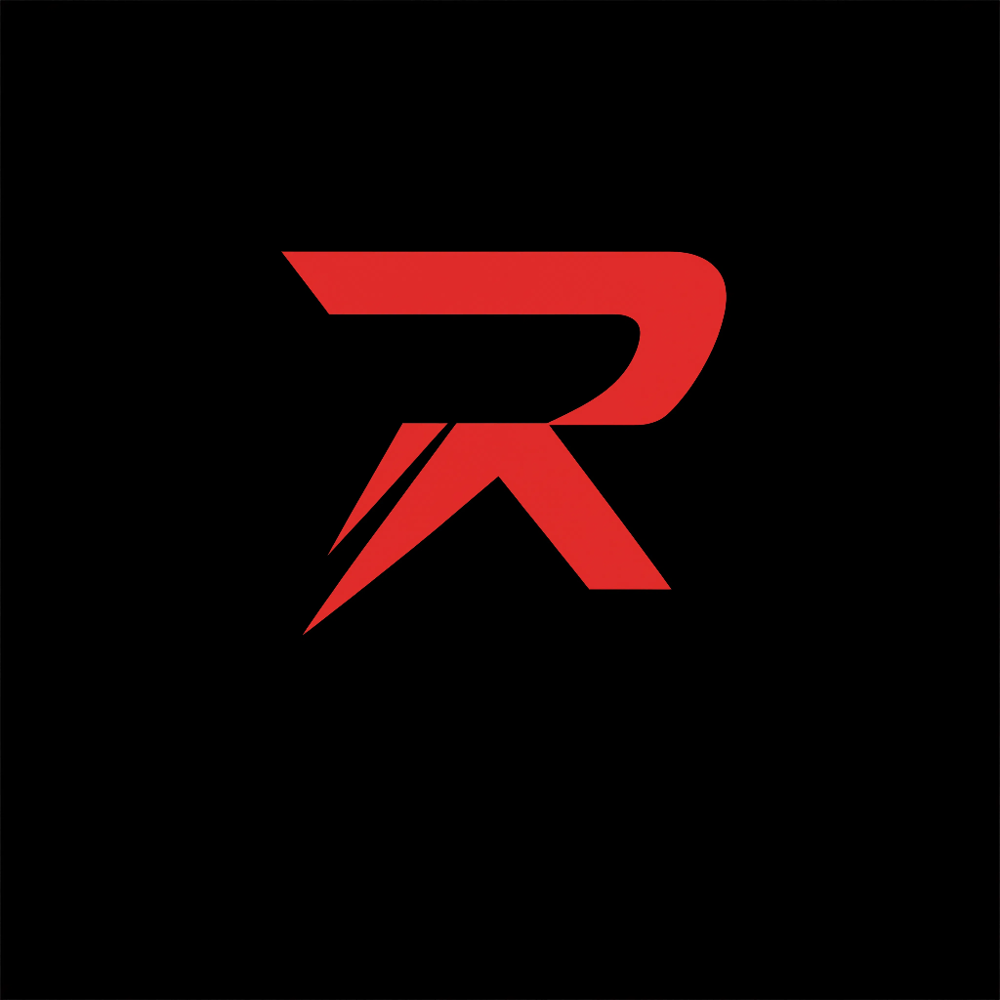
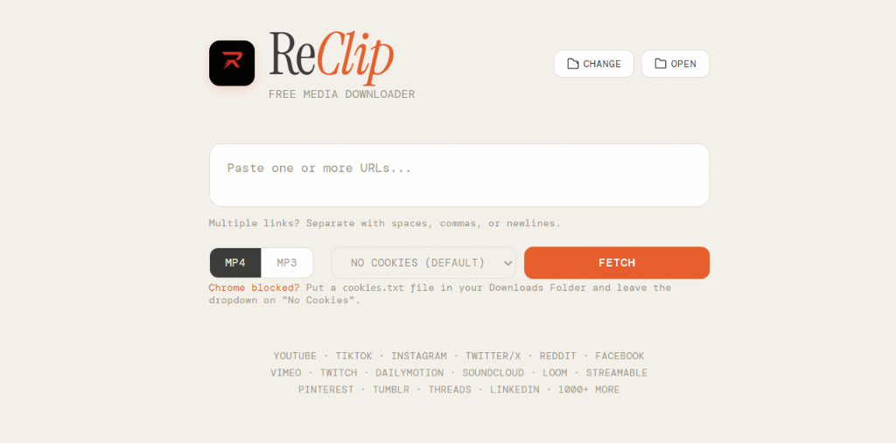

<div align="center">
  

  # ReClip — Desktop & Android Media Downloader

  **A fast, native media downloading application for Windows and Android.**  
  Download videos and audio from YouTube, TikTok, Instagram, Twitter/X, and 1000+ other platforms in MP4 or MP3 format with real-time progress indicators, precise file size estimation, and system gallery integration.

  <br>

  

  <br><br>

  
  
  
  
</div>

---

## Features

- **Native Android Application**: Powered by `youtubedl-android`, embedded multi-architecture FFmpeg, and an interface built with **Motion Primitives (`ibelick/motion-primitives`)**, Framer Motion, and Tailwind CSS.
- **Native Windows Desktop Application**: Embedded Microsoft Edge WebView2 architecture with zero browser dependency and silent background operations.
- **Real-Time Progress & Accurate Size Estimation**: Live download speed (`MB/s`), ETAs, percentage progress, and calibrated file size approximation.
- **Android System Share Sheet Integration**: Tap "Share" on any video in YouTube, Twitter/X, Instagram, TikTok, or Reddit and select **ReClip** to fetch and download instantly.
- **Resilient Android Foreground Service**: Continuous background downloading service with notification bar progress; tasks complete uninterrupted even when the screen is locked.
- **Automatic MediaStore Registration**: Saved media directly indexes into Android's public `Downloads/ReClip` directory, showing up immediately in VLC, Google Photos, and system players.
- **Cookie Bypass (`cookies.txt`)**: Import or paste `cookies.txt` to bypass YouTube bot detection, age restrictions, and platform verification barriers.
- **Multi-Resolution Video & Audio Dub Tracks**: Full resolution selection from 360p, 480p, 720p, 1080p, up to 4K, alongside multi-language audio track selection and multi-audio MKV support.
- **1000+ Supported Platforms**: YouTube, TikTok, Instagram, Twitter/X, Reddit, Facebook, Vimeo, Twitch, SoundCloud, Pinterest, Loom, Threads, and more.

---

## Downloads & Installation

### Android (.apk)
1. Download the latest **[`ReClip_v1.0.5_Android.apk`](https://github.com/Fazzbro/Reclip/releases/tag/v1.3.1)** from [GitHub Releases](https://github.com/Fazzbro/Reclip/releases/tag/v1.3.1).
2. Install on any Android device running Android 7.0 (API 24) or newer.

```bash
adb install ReClip_v1.0.5_Android.apk
```

### Windows Desktop (.exe)
1. Download **`ReClip_v1.2.0_Setup.exe`** from [GitHub Releases](https://github.com/Fazzbro/Reclip/releases/tag/v1.2.0) and run the installer.
2. Alternatively, run `dist/ReClip/ReClip.exe` directly.

---

## Setup Guide: YouTube & Chrome DPAPI Bypass

Google Chrome 127+ introduced **App-Bound Encryption**, preventing desktop applications from copying cookies directly from the browser process. This can lead to `ERROR: Could not copy Chrome cookie database` or `Failed to decrypt with DPAPI` when downloading certain restricted YouTube media.

**To bypass this:**
1. Open Google Chrome.
2. Navigate to `chrome://extensions/` and enable **Developer Mode**.
3. Click **Load unpacked** and select the `chrome_extension` folder located within this repository.
4. Click the **ReClip Cookie Exporter** extension icon and select **"Export cookies.txt"**.
5. Save or import the `cookies.txt` file directly into ReClip (via the **Cookies Tab** in Android or the **Downloads/ReClip** folder on Windows).
6. Fetch your video; ReClip automatically applies the cookies to bypass verification prompts.

---

## Building from Source

### Building Android APK
```bash
# 1. Compile the Motion Primitives frontend assets
cd frontend
npm install
npm run build

# 2. Compile and package the Android APK
cd ../android
./gradlew assembleRelease
```
*Output APK located in `android/app/build/outputs/apk/release/app-release.apk`.*

### Building Windows Executable
```powershell
python build_windows_app.py
```
*Compiles `ReClip.exe` with standard packaging into `dist/ReClip/`.*

---

## License

This project is licensed under the [MIT License](LICENSE).
